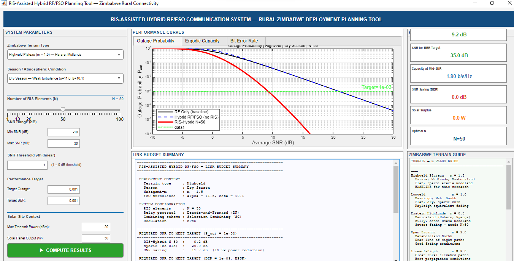

# RIS Deployment Planning Tool

A MATLAB planning tool for **RIS-assisted hybrid RF/FSO relay links in rural Zimbabwe**. It implements a complete closed-form analytical framework — end-to-end outage probability, ergodic capacity, and average bit error rate — behind an interactive GUI, so that rural network operators and telecommunications planners can compute site-specific link budgets **without needing the underlying mathematical derivations**.

Developed as part of a Master of Technology research project in Telecommunications and Wireless Systems at the Harare Institute of Technology (HIT), Zimbabwe.



**[TO ADD: copy the GUI screenshot used in the SoftwareX manuscript into `docs/screenshot.png`]**

## What it computes

The tool models a three-stage topology — source → reconfigurable intelligent surface (RIS) → decode-and-forward relay → destination — with parallel RF and FSO links on the second hop and selection combining at the destination. RF links follow the Nakagami-m fading model with the *m* parameter mapped to Zimbabwe terrain types; the FSO link follows the Gamma-Gamma turbulence model with parameters mapped to Zimbabwe's dry and rainy seasons. The RIS cascaded first hop is characterised by a Central Limit Theorem approximation (validated for N ≥ 20 elements).

The user selects one of **five Zimbabwe terrain classes** (setting the Nakagami-m parameter), one of **three seasonal atmospheric regimes** (setting the Gamma-Gamma parameters), a **RIS array size between 1 and 100 elements**, and outage/BER targets. The tool then evaluates:

- **Outage probability**, **ergodic capacity**, and **average BER** vs. average transmit SNR — each plot overlaying the RF-only, hybrid-without-RIS, and RIS-assisted configurations
- **Key result boxes**: the minimum SNR needed to meet the outage and BER targets, the SNR saving delivered by the RIS, the surplus solar power that saving releases, and a recommended array size
- A plain-language **link budget summary** for the selected operating point

## Requirements

- MATLAB **R2018b or later**
- **No additional toolboxes.** All computations use built-in functions only: `integral()`, `gammainc()`, `erfc()`, and `besselk()`.
- Runs on any desktop platform supported by MATLAB (Windows, macOS, Linux).

## Quick start

1. Download or clone this repository, or save `RIS_Planning_Tool.m` to your MATLAB working directory.
2. Open MATLAB and navigate to that folder (`pwd` to check your current directory, `cd('path')` to change it).
3. In the Command Window, run:

   ```matlab
   RIS_Planning_Tool
   ```

4. The GUI opens and immediately runs an initial computation using the default **Highveld Plateau** terrain and **Moderate** turbulence parameters.
5. Select your deployment terrain and season from the dropdown menus, adjust the system parameters, and click the green **COMPUTE RESULTS** button.
6. To save a text report, click the orange **EXPORT REPORT** button and choose a save location. The report is timestamped automatically.

## The interface

The window is divided into five panels:

| Panel | Contents |
|---|---|
| Left | All input controls (terrain, season, system parameters) |
| Centre-top | Three tabbed performance plots (outage, capacity, BER) |
| Centre-bottom | Link budget summary text |
| Right-top | Six key result boxes |
| Right-bottom | Zimbabwe terrain and season reference guide |

## Zimbabwe channel parameter reference

The tool's terrain and season presets are calibrated from published propagation studies in comparable sub-Saharan environments (full evidence base in the thesis, Appendix IV).

### Terrain → Nakagami-m (RF links)

| Terrain category | Representative regions | m | Elevation |
|---|---|---|---|
| Highveld Plateau *(baseline)* | Harare and surrounds, Midlands, central Mashonaland | 1.5 | 1,200–1,500 m |
| Lowveld | Masvingo, Matabeleland South, Gonarezhou area | 1.0 | 300–600 m |
| Eastern Highlands | Manicaland: Mutare, Nyanga, Chipinge, Vumba | 0.5 | 1,500–2,592 m |
| Open Savanna | Matabeleland North, Hwange, Zambezi Valley | 2.0 | < 600 m |
| Near line-of-sight | Very flat paths with long clear sightlines | 3.0 | < 600 m |

### Season → Gamma-Gamma turbulence (FSO link)

| Condition | α | β | Zimbabwe seasonal mapping |
|---|---|---|---|
| Weak turbulence | 11.6 | 10.1 | Dry season (May–September): clear skies, minimal convective turbulence |
| Moderate turbulence *(baseline)* | 4.0 | 1.9 | Year-round Highveld average: moderate solar heating, occasional cloud |
| Strong turbulence | 4.2 | 1.4 | Rainy season (October–April): high humidity, convective cloud, highland fog |

Baseline configuration used throughout the accompanying publications: N = 50 RIS elements, m = 1.5, α = 4.0, β = 1.9, threshold SNR γ<sub>th</sub> = 1, transmit SNR swept from −10 to +30 dB.

## Exported report format

**EXPORT REPORT** saves a plain-text file named `RIS_Planning_Report_YYYYMMDD_HHMMSS.txt` containing two sections: a link budget summary matching the on-screen display, and a full numerical table listing outage probability, ergodic capacity, and BER at every SNR point in the specified range. A sample report is included in [`examples/`](examples/).

**[TO ADD: run the tool once with default settings and commit the exported report as `examples/sample_report.txt`]**

## Validity notes

- The CLT approximation used for the RIS cascaded channel is accurate for **N ≥ 20** elements (relative error below 0.5% for N = 10–20, rising to ~9% at N = 5). Treat small-N results as indicative only.
- Analytical results carry a formal verification guarantee (against Monte Carlo simulation, relative error < 4%) over the −10 to +12 dB SNR range; see the thesis, Section 4.2, for details.

## Repository contents

```
RIS_Planning_Tool.m    Single-file MATLAB application (GUI + analytical engine)
README.md              This file
LICENSE                MIT licence
CITATION.cff           Citation metadata
docs/screenshot.png    GUI screenshot
examples/              Sample exported report
```

## How to cite

If you use this tool in your research, please cite it (GitHub's "Cite this repository" button uses [`CITATION.cff`](CITATION.cff)):

> Mzembi, T., & Rushambwa, M. C. (2026). *RIS Deployment Planning Tool* (Version 1.0.0) [Computer software]. https://github.com/tmzembi/RIS-Planning-Tool

The underlying analytical framework is described in:

> Mzembi, T. (2026). *Design, Modelling, and Performance Optimisation of a RIS-Assisted Hybrid RF/FSO Communication System for Reliable Rural Connectivity in Zimbabwe* [M.Tech thesis, Harare Institute of Technology].


## Authors

- **Tinotenda Mzembi** — Harare Institute of Technology ([ORCID 0009-0007-9915-3873](https://orcid.org/0009-0007-9915-3873)) — tmzembi@hit.ac.zw
- **Eng. Munyaradzi Charles Rushambwa** — Harare Institute of Technology ([ORCID 0000-0001-7452-7612](https://orcid.org/0000-0001-7452-7612))

## License

Released under the [MIT License](LICENSE). MATLAB is a proprietary product of The MathWorks, Inc.; the licence below applies to the code in this repository only.
